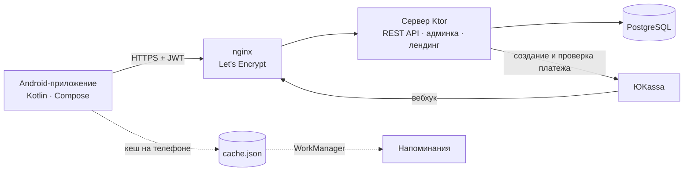

<p align="center"></p>

<p align="center">
  <a href="https://subly.antonshkel.ru/download"><b>Скачать APK</b></a> ·
  <a href="https://subly.antonshkel.ru">Сайт</a> ·
  <a href="docs/DEPLOY.md">Развернуть свой сервер</a> ·
  <a href="docs/ROADMAP.md">План развития</a>
</p>

<p align="center">
  <a href="https://github.com/antonshkelll/Subly/actions/workflows/android.yml"></a>
  <a href="https://github.com/antonshkelll/Subly/actions/workflows/server.yml"></a>
  
  
  
</p>

# Subly

Subly — приложение для тех, кто платит за Кинопоиск, музыку, облако, ChatGPT, связь и спортзал и уже не помнит, сколько всё это стоит вместе. Подписки добавляются один раз, после чего приложение показывает сумму в месяц и в год, напоминает за день до списания и подсказывает, от чего можно отказаться.

В репозитории лежит всё, что нужно для работы сервиса: Android-приложение на Kotlin и Jetpack Compose, сервер на Ktor с PostgreSQL, оплата Pro через ЮKassa, веб-админка с метриками и лендинг. Сервер запускается одной командой на любом VPS.

## Экраны

| Обзор | Подписки | Добавление | Советы (Pro) |
|:---:|:---:|:---:|:---:|
|  |  |  |  |
| **Subly Pro** | **Тёмная тема** | **Вход** | **Профиль** |
|  |  |  |  |

Скриншоты рендерят тесты ([`ScreenshotTest.kt`](android/app/src/test/kotlin/ru/antonshkel/subly/ScreenshotTest.kt)), и GitHub Actions перерисовывает их при каждом изменении интерфейса.

## Зачем это нужно

У обычного человека 5–10 платных подписок. Списания мелкие и приходятся на разные дни, поэтому общую сумму никто не видит, а пробные периоды незаметно становятся платными. Банковское приложение покажет операции, но не скажет, что у вас два музыкальных сервиса или что пробный Кинопоиск через три дня начнёт списывать деньги.

Что делает Subly:

1. Считает итог. Недельные, квартальные и годовые тарифы пересчитываются в месяц и складываются в одну сумму с разбивкой по категориям.
2. Напоминает о списаниях. Уведомление приходит за 0–7 дней до оплаты, срок выбирается для каждой подписки. Напоминания считаются на телефоне и работают без интернета.
3. Помогает тратить меньше. Советы находят дубли по категориям, заканчивающиеся пробные периоды, еженедельные тарифы и подписки, которые занимают 40% бюджета и больше. Экономия считается в рублях.

Доступ к банку приложению не нужен: оно не читает SMS и не просит данные карт или логины. Так сделано намеренно. Такому приложению проще доверять, и его не нужно сертифицировать.

## Как этим пользоваться

1. Установите APK и создайте аккаунт по почте (данные синхронизируются между телефонами).
2. Нажмите «+», выберите сервис из популярных или впишите свой, укажите цену и дату ближайшего списания.
3. На «Обзоре» появится сумма в месяц и список того, что спишется в ближайшие 30 дней. За день до оплаты придёт уведомление.

| | Free | Pro |
|---|:---:|:---:|
| Подписки | до 5 | без ограничений |
| Сумма в месяц и в год, категории | ✓ | ✓ |
| Напоминания | ✓ | ✓ |
| Советы по экономии | — | ✓ |
| Экспорт в CSV (Excel) | — | ✓ |
| Цена | 0 ₽ | 149 ₽/мес или 1 190 ₽/год |

Pro оплачивается в ЮKassa картой или через СБП, разово, без автопродления.

## Как устроено



| Часть | Стек | Где |
|---|---|---|
| Android | Kotlin 2.1, Jetpack Compose (Material 3), Ktor Client, kotlinx.serialization, DataStore, WorkManager | [`android/`](android) |
| Сервер | Ktor 3 (Netty), Exposed, PostgreSQL / H2, JWT, bcrypt, rate limiting | [`server/`](server) |
| Веб | Лендинг, админка, политика — чистый HTML/CSS/JS без сборщиков, отдаёт сам сервер | [`server/src/main/resources/web`](server/src/main/resources/web) |
| Деплой | Docker Compose (PostgreSQL + JRE), nginx, certbot, скрипт установки | [`deploy/`](deploy) |
| CI | Тесты сервера и приложения, release-APK с R8, скриншоты, релизы по тегу | [`.github/workflows`](.github/workflows) |

### Почему Kotlin и Compose

С 2019 года Google развивает Android по принципу Kotlin-first: новые Jetpack-библиотеки и документация сначала выходят для Kotlin, а Jetpack Compose рекомендован как основной способ делать интерфейс. Flutter и React Native удобны, когда нужен ещё и iOS. Приложение только под Android на нативном Kotlin получается с меньшим APK, быстрее запускается и напрямую работает с WorkManager, уведомлениями и системными настройками. Сервер тоже написан на Kotlin, поэтому модели данных в приложении и на сервере почти совпадают.

### Почему быстро работает на слабых телефонах

Цель — плавные 60 кадров в секунду на Android 7 с 2 ГБ памяти. Для этого сделано следующее:

- Анимации идут только через `graphicsLayer` (масштаб, сдвиг, прозрачность). Они не вызывают перерасчёт раскладки, их считает видеокарта.
- В интерфейсе нет blur и теней-«стёкол». Размытие дорогое и доступно только на Android 12+, поэтому там, где в iOS было бы стекло, используются полупрозрачность и градиенты.
- Бесконечная анимация одна, на онбординге. Остальные проигрываются один раз (сумма «досчитывается», кольцо диаграммы прорисовывается) и останавливаются.
- Списки построены на `LazyColumn` с ключами: рисуются только видимые строки, а `animateItem` плавно переставляет их при смене сортировки.
- Приложение стартует без сети: данные сначала читаются из локального кеша и потом обновляются с сервера. Окно сразу открывается нужного цвета, без белой вспышки.
- R8 и shrinkResources вырезают из APK неиспользуемый код и ресурсы. Иконки и иллюстрации нарисованы кодом и векторами, растровых картинок в APK нет.
- Baseline-профили Compose ставятся через `profileinstaller`, поэтому первый запуск не тормозит даже при установке APK не из магазина.
- В тёмной теме фон чисто чёрный: на OLED-экранах чёрные пиксели не светятся и не тратят батарею.
- Системная настройка «Убрать анимацию» учитывается автоматически, потому что Compose берёт масштаб анимаций из настроек Android.

## Запуск

### Скачать готовое приложение

Откройте на телефоне [subly.antonshkel.ru/download](https://subly.antonshkel.ru/download) и разрешите установку из этого источника. По умолчанию приложение работает с сервером `subly.antonshkel.ru`, адрес можно поменять на экране входа («Сервер: …»).

### Сервер у себя на компьютере

Нужна Java 21. По умолчанию база хранится в файле H2 в `server/data`, так что PostgreSQL для разработки ставить не нужно.

macOS и Linux:

```bash
git clone https://github.com/antonshkelll/Subly.git
cd Subly/server
PAYMENTS_DEMO=true ADMIN_EMAILS=admin@example.com ./gradlew run
```

Windows (PowerShell):

```powershell
git clone https://github.com/antonshkelll/Subly.git
cd Subly\server
$env:PAYMENTS_DEMO="true"; $env:ADMIN_EMAILS="admin@example.com"; .\gradlew.bat run
```

Вместо `admin@example.com` впишите свою почту: с ней вы войдёте в админку.

- Когда в консоли появится `Responding at http://0.0.0.0:8080`, откройте в браузере `localhost:8080`: там лендинг, а на `localhost:8080/admin` админка. Чтобы войти в админку, зарегистрируйте в приложении почту из `ADMIN_EMAILS`.
- `PAYMENTS_DEMO=true` включает Pro без оплаты, так удобно проверить все экраны. На боевом сервере этот режим запрещён.
- Тесты запускаются командой `./gradlew test`. Они проверяют регистрацию, права доступа, лимиты, полный цикл оплаты с поддельной ЮKassa, советы и админку.

### Приложение в Android Studio

1. Android Studio (Ladybug или новее) → **Open** → папка `android`.
2. Дождитесь синхронизации Gradle и нажмите ▶ **Run** (эмулятор или телефон с отладкой по USB).
3. На экране входа нажмите «Сервер: …» и введите `http://10.0.2.2:8080`. По этому адресу эмулятор видит сервер на вашем компьютере.

Подписание своим ключом, публикация в RuStore и остальные подробности описаны в [docs/ANDROID.md](docs/ANDROID.md).

### Свой сервер на VPS

Короткая версия ниже. Подробная инструкция с MobaXterm лежит в [docs/DEPLOY.md](docs/DEPLOY.md).

```bash
git clone https://github.com/antonshkelll/Subly.git
cd Subly
sudo bash deploy/setup.sh
```

Скрипт поставит Docker, поднимет PostgreSQL и сервер, добавит сайт в nginx и выпустит SSL. Другие сайты и боты на сервере он не трогает.

## API

Без токена работают вход и регистрация, `/api/categories`, `/api/billing/plans` и вебхук ЮKassa. Остальные запросы отправляются с заголовком `Authorization: Bearer <token>`.

| Метод | Путь | Что делает |
|---|---|---|
| POST | `/api/auth/register`, `/api/auth/login` | Регистрация и вход, возвращают токен |
| GET / DELETE | `/api/me` | Профиль; удаление аккаунта со всеми данными |
| GET | `/api/categories` | Список категорий подписок |
| GET / POST | `/api/subscriptions` | Список подписок; добавить (в Free — до 5) |
| PUT / DELETE | `/api/subscriptions/{id}` | Изменить, удалить |
| GET | `/api/insights` | Советы по экономии (Pro) |
| GET | `/api/export.csv` | Экспорт в CSV (Pro) |
| GET | `/api/billing/plans` | Тарифы Pro |
| POST | `/api/billing/checkout` | Создать платёж в ЮKassa, вернуть ссылку на оплату |
| POST | `/api/billing/refresh` | Проверить оплату после возврата из браузера |
| POST | `/api/billing/yookassa/webhook` | Уведомления ЮKassa |
| GET | `/api/admin/stats`, `/api/admin/users` | Метрики и пользователи для админки |
| POST | `/api/admin/users/{id}/pro` | Выдать пользователю Pro на заданное число дней (админка) |
| DELETE | `/api/admin/users/{id}` | Удалить пользователя (админка) |
| GET | `/health` | Проверка, что сервер и база отвечают |

Пароли хранятся в bcrypt, токены выдаются в виде JWT на 60 дней. На вход и регистрацию стоит лимит 10 запросов в минуту с одного IP. Вебхуку ЮKassa сервер не доверяет: берёт из него только id платежа и перепроверяет платёж через API ЮKassa, включая сумму. Повторное уведомление второй раз Pro не продлевает.

## Документация

- [docs/DEPLOY.md](docs/DEPLOY.md): установка на VPS через MobaXterm, шаг за шагом
- [docs/ANDROID.md](docs/ANDROID.md): сборка, подпись, публикация в RuStore
- [docs/ROADMAP.md](docs/ROADMAP.md): план развития и внедрения, метрики
- [docs/MONETIZATION.md](docs/MONETIZATION.md): тарифы, юнит-экономика, ЮKassa
- [docs/SEO.md](docs/SEO.md): продвижение лендинга и приложения

## Лицензия

MIT. Автор — [Антон Шкель](https://antonshkel.ru), Telegram [@antonshkelll](https://t.me/antonshkelll).

