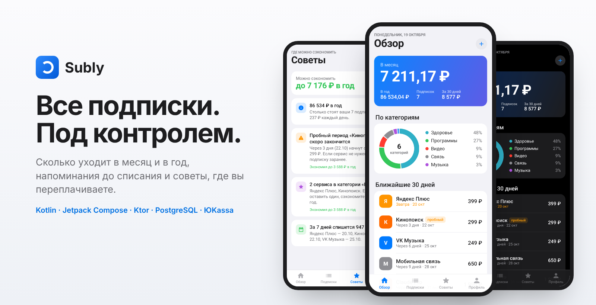
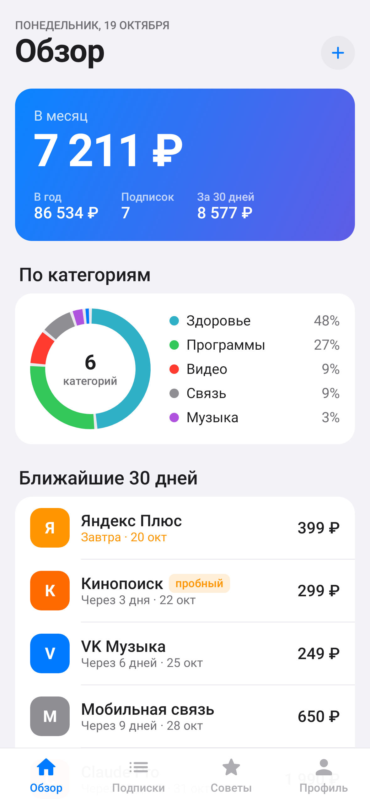
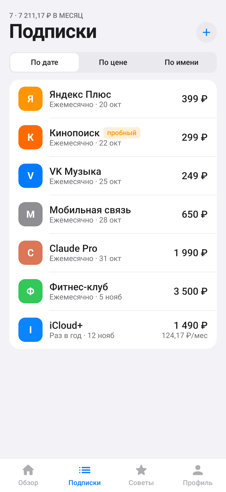
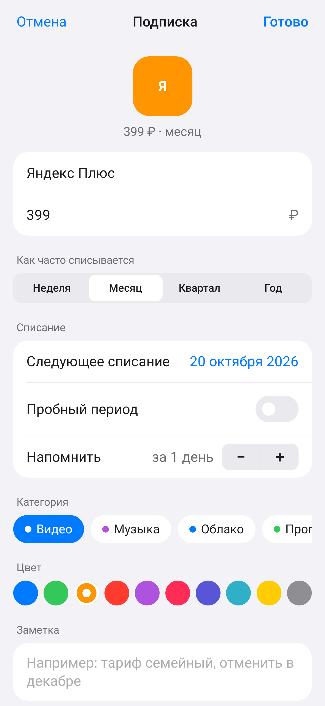
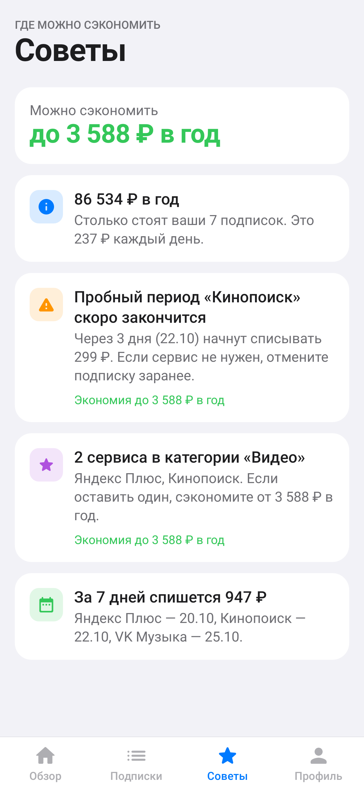
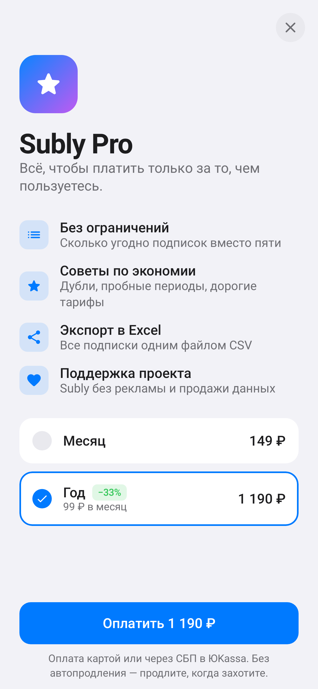
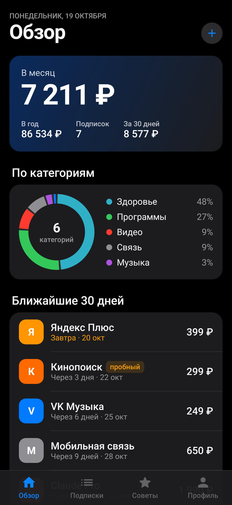
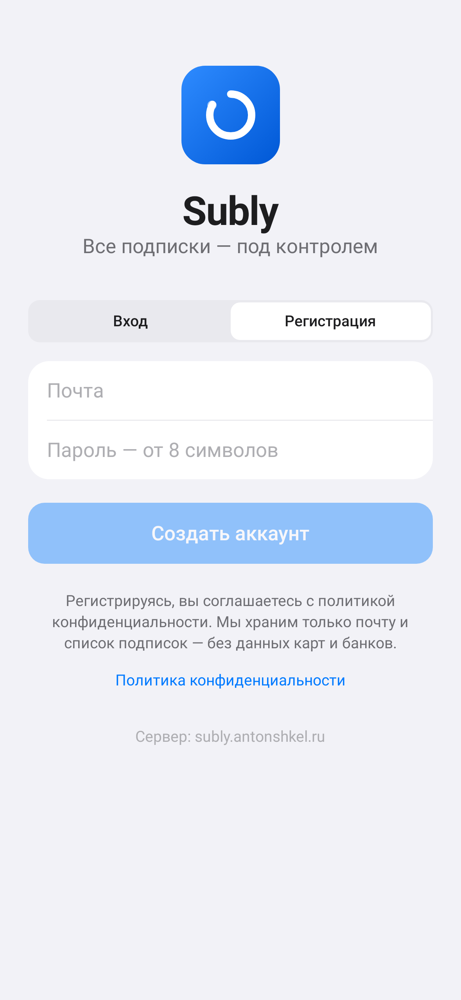
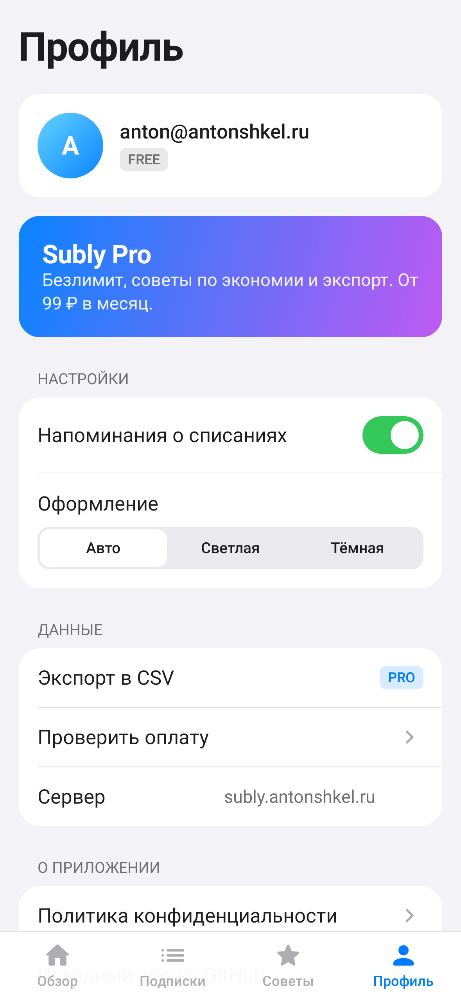
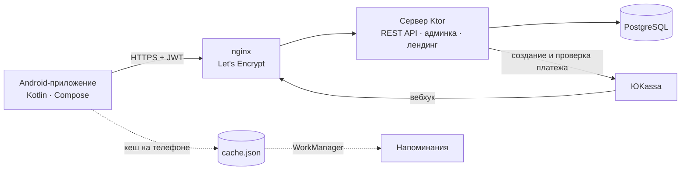

<p align="center"></p>

<p align="center">
  <a href="https://github.com/antonshkelll/Subly/releases/latest/download/subly.apk"><b>Скачать APK</b></a> ·
  <a href="https://subly.antonshkel.ru">Сайт</a> ·
  <a href="docs/DEPLOY.md">Развернуть свой сервер</a> ·
  <a href="docs/ROADMAP.md">План развития</a>
</p>

<p align="center">
  <a href="https://github.com/antonshkelll/Subly/actions/workflows/android.yml"></a>
  <a href="https://github.com/antonshkelll/Subly/actions/workflows/server.yml"></a>
  
  
  
</p>

# Subly

Subly — приложение для тех, кто платит за Кинопоиск, музыку, облако, ChatGPT, связь и спортзал и уже не помнит, сколько всё это стоит вместе. Добавляете подписки один раз, и приложение показывает сумму в месяц и в год, напоминает за день до списания и подсказывает, от чего можно отказаться.

Это полноценный SaaS: Android-приложение на Kotlin + Jetpack Compose, свой сервер на Ktor с PostgreSQL, оплата Pro через ЮKassa, веб-админка с метриками и лендинг. Всё в одном репозитории, запускается одной командой на любом VPS.

## Экраны

| Обзор | Подписки | Добавление | Советы (Pro) |
|:---:|:---:|:---:|:---:|
|  |  |  |  |
| **Subly Pro** | **Тёмная тема** | **Вход** | **Профиль** |
|  |  |  |  |

Скриншоты не нарисованы в Figma: их рендерят тесты ([`ScreenshotTest.kt`](android/app/src/test/kotlin/ru/antonshkel/subly/ScreenshotTest.kt)), и GitHub Actions обновляет их при каждом изменении интерфейса.

## Зачем это нужно

У обычного человека 5–10 платных подписок. Списания мелкие и в разные дни, поэтому общую сумму никто не видит, а пробные периоды тихо превращаются в платные. Банковские приложения показывают операции, но не говорят, что у вас два музыкальных сервиса, или что пробный Кинопоиск через три дня начнёт списывать деньги.

Subly решает три задачи:

1. **Видеть итог.** Недельные, квартальные и годовые тарифы пересчитываются в месяц, и всё складывается в одну цифру с разбивкой по категориям.
2. **Не пропускать списания.** Уведомление за 0–7 дней до оплаты (выбирается для каждой подписки). Напоминания считаются на телефоне и работают без интернета.
3. **Тратить меньше.** Советы находят дубли по категориям, заканчивающиеся пробные периоды, еженедельные тарифы и подписки, которые съедают больше 40% бюджета. Экономия считается в рублях.

Доступ к банку не нужен: никаких SMS, карт и логинов. Это осознанное решение. Так приложению проще доверять, и его не нужно сертифицировать.

## Как этим пользоваться

1. Установите APK и создайте аккаунт по почте (данные синхронизируются между телефонами).
2. Нажмите «+», выберите сервис из популярных или впишите свой, укажите цену и дату ближайшего списания.
3. Готово. На «Обзоре» видно, сколько уходит в месяц и что спишется в ближайшие 30 дней. За день до оплаты придёт уведомление.

| | Free | Pro |
|---|:---:|:---:|
| Подписки | до 5 | без ограничений |
| Сумма в месяц и в год, категории | ✓ | ✓ |
| Напоминания | ✓ | ✓ |
| Советы по экономии | — | ✓ |
| Экспорт в CSV (Excel) | — | ✓ |
| Цена | 0 ₽ | 149 ₽/мес или 1 190 ₽/год |

Pro оплачивается в ЮKassa картой или через СБП, разово, без автопродления.

## Как устроено



| Часть | Стек | Где |
|---|---|---|
| Android | Kotlin 2.1, Jetpack Compose (Material 3), Ktor Client, kotlinx.serialization, DataStore, WorkManager | [`android/`](android) |
| Сервер | Ktor 3 (Netty), Exposed, PostgreSQL / H2, JWT, bcrypt, rate limiting | [`server/`](server) |
| Веб | Лендинг, админка, политика — чистый HTML/CSS/JS без сборщиков, отдаёт сам сервер | [`server/src/main/resources/web`](server/src/main/resources/web) |
| Деплой | Docker Compose (PostgreSQL + JRE), nginx, certbot, скрипт установки | [`deploy/`](deploy) |
| CI | Тесты сервера и приложения, release-APK с R8, скриншоты, релизы по тегу | [`.github/workflows`](.github/workflows) |

**Почему Kotlin и Compose.** Google с 2019 года развивает Android по принципу Kotlin-first: новые Jetpack-библиотеки и документация выходят в первую очередь для Kotlin, а Jetpack Compose — рекомендуемый способ делать интерфейс. Flutter и React Native удобны, когда нужен ещё и iOS. Для приложения только под Android нативный Kotlin даёт меньший APK, быстрый запуск и прямой доступ к WorkManager, уведомлениям и системным настройкам. Сервер тоже на Kotlin, поэтому модели данных в приложении и на сервере почти совпадают.

### Почему быстро работает на слабых телефонах

Цель — плавные 60 кадров в секунду на Android 7 с 2 ГБ памяти. Что для этого сделано:

- **Анимации только через `graphicsLayer`** (масштаб, сдвиг, прозрачность). Они не вызывают перерасчёт раскладки, их считает видеокарта.
- **Без blur и теней-«стёкол».** Размытие дорогое и есть только на Android 12+, поэтому полупрозрачность и градиенты заменяют его там, где в iOS было бы стекло.
- **Бесконечная анимация одна** — на онбординге. Остальные отрабатывают один раз (сумма «досчитывается», кольцо диаграммы прорисовывается) и останавливаются.
- **Списки на `LazyColumn` с ключами**: рисуются только видимые строки, а `animateItem` плавно переставляет их при смене сортировки.
- **Мгновенный старт без сети**: данные сначала читаются из локального кеша, потом обновляются с сервера. Окно приложения сразу нужного цвета, без белой вспышки.
- **R8 + shrinkResources**: из APK вырезается неиспользуемый код и ресурсы. Иконки и иллюстрации нарисованы кодом и векторами, картинок в APK нет.
- **Baseline-профили Compose** ставятся через `profileinstaller`, поэтому первый запуск не тормозит даже при установке APK не из магазина.
- **Чистый чёрный в тёмной теме**: на OLED-экранах чёрные пиксели не светятся и не тратят батарею.
- **Системная настройка «Убрать анимацию»** учитывается автоматически: Compose берёт масштаб анимаций из настроек Android.

## Запуск

### Скачать готовое приложение

[subly.apk](https://github.com/antonshkelll/Subly/releases/latest/download/subly.apk) → открыть на телефоне → разрешить установку из этого источника. По умолчанию приложение работает с сервером `subly.antonshkel.ru`. Адрес меняется на экране входа («Сервер: …»).

### Сервер у себя на компьютере

Нужна Java 21. База по умолчанию — файл H2 в `server/data`, PostgreSQL для разработки не нужен.

```bash
git clone https://github.com/antonshkelll/Subly.git
cd Subly/server
PAYMENTS_DEMO=true ADMIN_EMAILS=you@mail.ru ./gradlew run      # Windows: set PAYMENTS_DEMO=true && gradlew.bat run
```

- http://localhost:8080 — лендинг, http://localhost:8080/admin — админка (войдите почтой из `ADMIN_EMAILS`, зарегистрировав её в приложении).
- `PAYMENTS_DEMO=true` включает Pro без оплаты: удобно проверить все экраны. На боевом сервере этот режим запрещён.
- Тесты: `./gradlew test` (регистрация, права доступа, лимиты, полный цикл оплаты с поддельной ЮKassa, советы, админка).

### Приложение в Android Studio

1. Android Studio (Ladybug или новее) → **Open** → папка `android`.
2. Дождитесь синхронизации Gradle и нажмите ▶ **Run** (эмулятор или телефон с отладкой по USB).
3. На экране входа нажмите «Сервер: …» и введите `http://10.0.2.2:8080` — так эмулятор видит сервер на вашем компьютере.

Подробнее, включая подписание своим ключом и публикацию в RuStore: [docs/ANDROID.md](docs/ANDROID.md).

### Свой сервер на VPS

Коротко (подробно, с MobaXterm, — в [docs/DEPLOY.md](docs/DEPLOY.md)):

```bash
git clone https://github.com/antonshkelll/Subly.git
cd Subly
sudo bash deploy/setup.sh
```

Скрипт поставит Docker, поднимет PostgreSQL и сервер, добавит сайт в nginx и выпустит SSL. Другие сайты и боты на сервере он не трогает.

## API

Все запросы, кроме входа, — с заголовком `Authorization: Bearer <token>`.

| Метод | Путь | Что делает |
|---|---|---|
| POST | `/api/auth/register`, `/api/auth/login` | Регистрация и вход, возвращают токен |
| GET / DELETE | `/api/me` | Профиль; удаление аккаунта со всеми данными |
| GET / POST | `/api/subscriptions` | Список подписок; добавить (в Free — до 5) |
| PUT / DELETE | `/api/subscriptions/{id}` | Изменить, удалить |
| GET | `/api/insights` | Советы по экономии (Pro) |
| GET | `/api/export.csv` | Экспорт в CSV (Pro) |
| GET | `/api/billing/plans` | Тарифы Pro |
| POST | `/api/billing/checkout` | Создать платёж в ЮKassa, вернуть ссылку на оплату |
| POST | `/api/billing/refresh` | Проверить оплату после возврата из браузера |
| POST | `/api/billing/yookassa/webhook` | Уведомления ЮKassa |
| GET | `/api/admin/stats`, `/api/admin/users` | Метрики и пользователи для админки |

Безопасность: пароли хранятся в bcrypt, токены — JWT на 60 дней, на вход и регистрацию стоит лимит 10 запросов в минуту с одного IP. Вебхуку ЮKassa сервер не доверяет: берёт из него только id и перепроверяет платёж через API ЮKassa, включая сумму. Повторное уведомление Pro второй раз не продлевает.

## Документация

- [docs/DEPLOY.md](docs/DEPLOY.md) — установка на VPS через MobaXterm, шаг за шагом
- [docs/ANDROID.md](docs/ANDROID.md) — сборка, подпись, публикация в RuStore
- [docs/ROADMAP.md](docs/ROADMAP.md) — план развития и внедрения, метрики
- [docs/MONETIZATION.md](docs/MONETIZATION.md) — тарифы, юнит-экономика, ЮKassa
- [docs/SEO.md](docs/SEO.md) — продвижение лендинга и приложения

## Лицензия

MIT. Автор — [Антон Шкель](https://antonshkel.ru), Telegram [@antonshkelll](https://t.me/antonshkelll).
